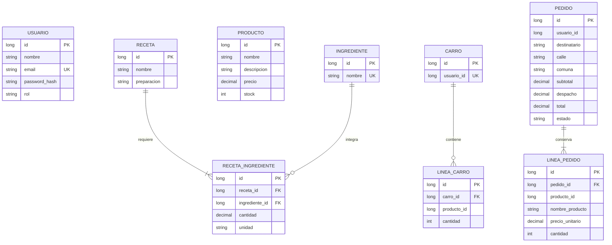

# Modelo de datos de Our Sour

## Separación por servicio

Los tres servicios usan una base exclusiva MariaDB llamada our_sour. Cada servicio mantiene la propiedad de sus tablas mediante prefijos auth_, catalogo_ y pedidos_. Eureka y Gateway no almacenan datos de negocio. Los identificadores de usuario y producto que cruzan servicios se guardan como valores, sin claves foráneas entre tablas de distintos servicios.

| Servicio | Esquema | Responsabilidad |
|---|---|---|
| ms-auth | our_sour (auth_*) | Usuarios, credenciales cifradas con hash y roles |
| ms-catalogo | our_sour (catalogo_*) | Ingredientes, productos, recetas y dosificaciones |
| ms-pedidos | our_sour (pedidos_*) | Carro, dirección y pedidos con valores históricos |

## Diseño lógico

Este es el diseño de las entidades de negocio. Por ahora existen las tablas `catalogo_productos` y `catalogo_ingredientes`, creadas por JPA en our_sour; el resto se agregará al implementar y verificar cada conjunto.

La dosificación pertenece a la relación entre receta e ingrediente. El pedido conserva nombre y precio histórico; editar un producto no debe modificar una compra anterior. El servidor calcula subtotal, despacho y total. El identificador del propietario se obtiene del usuario autenticado, no de un campo confiado al cliente.

## Almacenamiento móvil de esta evaluación

Room usa la tabla `frequent_ingredients` con `ingredientId` como clave primaria. El DAO ignora inserciones repetidas y permite observar y eliminar los frecuentes. Los perfiles, carro, catálogo editable y pedidos móviles son estados de demostración en memoria; no están conectados a MySQL.
